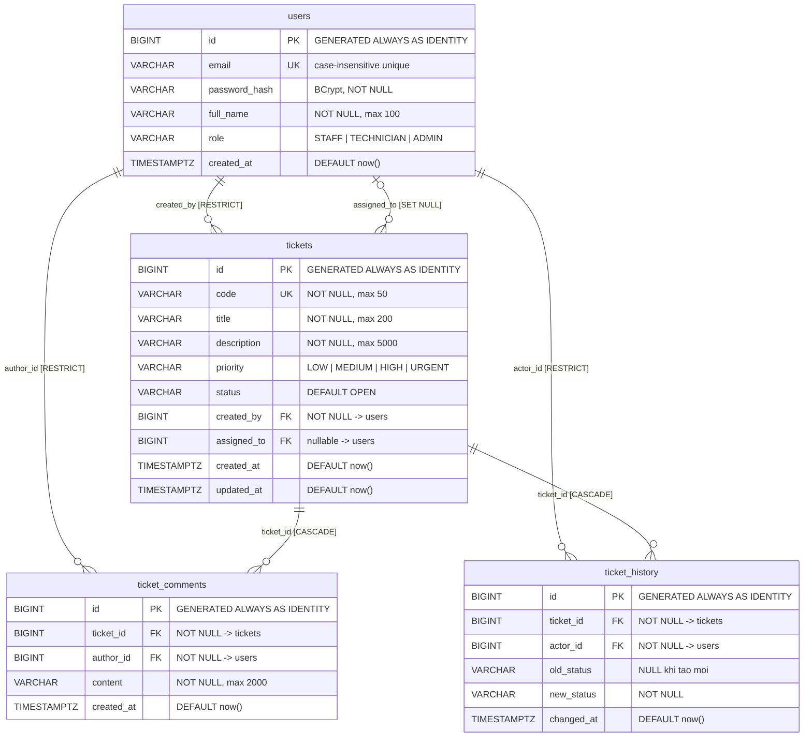

# Entity-Relationship Diagram — TechByte Service Desk

> [!NOTE]
> Sơ đồ phản ánh schema `V001__init.sql`. Mọi thay đổi schema phải tạo migration mới và cập nhật lại ERD.

## Sơ đồ ERD

## Chính sách xóa (ON DELETE)

| Quan hệ FK | Hành vi | Lý do |
|---|---|---|
| `tickets.created_by → users.id` | **RESTRICT** | Không cho xóa user nếu đã tạo ticket — bảo toàn truy vết |
| `tickets.assigned_to → users.id` | **SET NULL** | Cho phép xóa technician; trường assigned_to chuyển thành NULL |
| `ticket_comments.ticket_id → tickets.id` | **CASCADE** | Xóa ticket → xóa tất cả bình luận liên quan (xóa vật lý theo quyết định PM) |
| `ticket_comments.author_id → users.id` | **RESTRICT** | Không cho xóa user nếu đã bình luận |
| `ticket_history.ticket_id → tickets.id` | **CASCADE** | Xóa ticket → xóa tất cả lịch sử trạng thái |
| `ticket_history.actor_id → users.id` | **RESTRICT** | Không cho xóa user nếu đã thực hiện thay đổi trạng thái |

## Ghi chú quan hệ

- **users ↔ tickets (created_by):** Quan hệ 1-n bắt buộc. Mỗi ticket phải có đúng 1 người tạo.
- **users ↔ tickets (assigned_to):** Quan hệ 1-n tuỳ chọn (nullable). Chỉ TECHNICIAN mới được phân công (PM đã chốt; validate ở Backend).
- **tickets ↔ ticket_comments:** Quan hệ 1-n. Mỗi ticket có 0 hoặc nhiều bình luận.
- **tickets ↔ ticket_history:** Quan hệ 1-n. Mỗi ticket có ít nhất 1 bản ghi lịch sử (tạo ban đầu: `old_status = NULL`, `new_status = 'OPEN'`).

