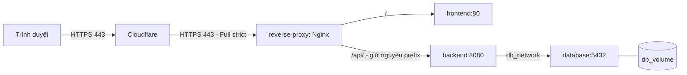

# Docker và Nginx trên VPS — TechByte Service Desk

## 1. Các file và luồng request

| File | Mục đích |
| --- | --- |
| `frontend/Dockerfile` | Node 22 build React/Vite; Nginx phục vụ thư mục `dist` |
| `backend/Dockerfile` | Maven + Java 21 build JAR; Java 21 JRE chạy bằng user thường |
| `docker-compose.yml` | Chạy bộ production trên VPS |
| `infra/compose/compose.prod.yml` | Bốn service chạy trên VPS, HTTPS ở Nginx |
| `infra/compose/env.example` | Mẫu biến môi trường; phải sao chép thành `.env` riêng |
| `infra/nginx/default.conf` | Template reverse proxy HTTPS trên VPS |
| `infra/nginx/frontend.conf` | Static files, cache assets và fallback React Router |



Nginx chạy trong container `reverse-proxy` trên VPS. Cổng 80/443 dành cho container
này; kiểm tra dịch vụ đang chiếm cổng bằng `sudo ss -ltnp` trước khi khởi động.
Các file cấu hình trong repo dùng cho server; không cần cài Nginx trên máy phát triển. Chỉ reverse proxy được publish cổng. Database và backend nằm trong mạng Docker;
`db_network` là mạng nội bộ, chỉ backend và database tham gia.

## 2. Chuẩn bị VPS Ubuntu

Đưa các file Docker/Nginx mới lên nhánh GitHub dùng triển khai trước khi clone/pull
trên VPS. Có thể dùng thư mục dự án đã clone sẵn; các lệnh dưới đây giả định repo
ở `/opt/techbyte/source` và bạn đang đứng tại thư mục đó.

Cài Docker theo [hướng dẫn Ubuntu chính thức](https://docs.docker.com/engine/install/ubuntu/).
Nếu VPS chưa cài Docker, dùng apt repository của Docker:

```bash
sudo apt update
sudo apt install -y ca-certificates curl git openssl
sudo install -m 0755 -d /etc/apt/keyrings
sudo curl -fsSL https://download.docker.com/linux/ubuntu/gpg -o /etc/apt/keyrings/docker.asc
sudo chmod a+r /etc/apt/keyrings/docker.asc

sudo tee /etc/apt/sources.list.d/docker.sources >/dev/null <<EOF
Types: deb
URIs: https://download.docker.com/linux/ubuntu
Suites: $(. /etc/os-release && echo "${UBUNTU_CODENAME:-$VERSION_CODENAME}")
Components: stable
Architectures: $(dpkg --print-architecture)
Signed-By: /etc/apt/keyrings/docker.asc
EOF

sudo apt update
sudo apt install -y docker-ce docker-ce-cli containerd.io docker-buildx-plugin docker-compose-plugin
sudo systemctl enable --now docker
sudo usermod -aG docker "$USER"
```

Đăng xuất rồi SSH lại để nhận quyền nhóm Docker, sau đó kiểm tra:

```bash
docker version
docker compose version
```

Firewall của nhà cung cấp VPS cần cho phép HTTPS 443, HTTP 80 nếu dùng redirect và
SSH theo IP/quy định lab. Docker publish cổng có thể đi ngoài quy tắc UFW; ưu tiên
kiểm soát tại firewall của nhà cung cấp hoặc quy tắc dành cho Docker.

## 3. Domain và chứng chỉ Cloudflare

Ví dụ dùng `desk.example.com`; thay bằng domain thật của nhóm.

1. Cloudflare DNS: tạo bản ghi `A` cho hostname, trỏ tới IPv4 VPS và bật **Proxied**.
2. Vào **SSL/TLS -> Origin Server -> Create Certificate**. Tạo chứng chỉ cho đúng
   hostname; lưu Origin Certificate và Private Key vào hai file bên dưới.
3. Vào **SSL/TLS -> Overview**, chọn **Full (strict)**. Origin phải có chứng chỉ đúng
   hostname, còn hạn. Chứng chỉ Origin CA dùng cho chặng Cloudflare -> VPS.
4. Đặt quy tắc bypass cache cho `/api/*`; không dùng cache toàn bộ website cho API
   hoặc phản hồi đăng nhập.

[Hướng dẫn Origin CA](https://developers.cloudflare.com/ssl/origin-configuration/origin-ca/)
và [Full (strict)](https://developers.cloudflare.com/ssl/origin-configuration/ssl-modes/full-strict/).

Tạo thư mục và lưu chứng chỉ trên VPS:

```bash
sudo install -d -m 0750 -o "$USER" -g "$(id -gn)" /opt/techbyte/shared/tls
nano /opt/techbyte/shared/tls/origin.crt
nano /opt/techbyte/shared/tls/origin.key
chmod 644 /opt/techbyte/shared/tls/origin.crt
chmod 600 /opt/techbyte/shared/tls/origin.key
```

`origin.crt` chứa khối `BEGIN CERTIFICATE`; `origin.key` chứa private key tương ứng.
Giữ các file này trên VPS, ngoài repository.

## 4. Cấu hình biến môi trường production

Trong thư mục repository trên VPS:

```bash
cp infra/compose/env.example infra/compose/.env
chmod 600 infra/compose/.env
openssl rand -hex 32
openssl rand -hex 32
nano infra/compose/.env
```

Dùng hai chuỗi vừa tạo cho hai biến bí mật khác nhau, điền các giá trị còn lại:

```dotenv
POSTGRES_DB=servicedesk
POSTGRES_USER=servicedesk_user
POSTGRES_PASSWORD=<chuỗi-ngẫu-nhiên-thứ-nhất>
JWT_SECRET=<chuỗi-ngẫu-nhiên-thứ-hai>
APP_DOMAIN=desk.example.com
APP_URL=https://desk.example.com
APP_ENV_FILE=.env
TLS_DIR=/opt/techbyte/shared/tls
```

`APP_DOMAIN` chỉ là hostname; `APP_URL` gồm `https://`. Compose đưa `APP_DOMAIN` vào
template Nginx khi container khởi động; không cần sửa domain trực tiếp trong config.
React đã build với API `/api`, dùng cùng domain với giao diện.

Database là PostgreSQL 16 theo tài liệu nhóm DB. Named volume thực tế là `db_volume`
và container tên `database` để tương thích các script backup đang có. Xác nhận với
người phụ trách DB nếu VPS đã có một database/volume mang tên này.

## 5. Build và chạy production

Chạy trên VPS. Tạo hàm shell để các lệnh dùng đúng file production:

```bash
dc() {
  docker compose --env-file infra/compose/.env -f infra/compose/compose.prod.yml "$@"
}

dc config --quiet
dc up --build -d --wait --wait-timeout 180
dc ps
dc exec -T reverse-proxy nginx -t
dc exec -T backend curl -fsS http://127.0.0.1:8080/ready
curl -I https://desk.example.com
curl -fsS https://desk.example.com/api/ready
```

Khởi động lần đầu có thể mất vài phút để tải image, npm packages và Maven dependencies.
Production tắt demo seed; phối hợp nhóm DB/BE tạo tài khoản sử dụng. Readiness trả `{"status":"READY","database":"UP"}`. Spring Boot chạy Flyway trên các SQL trong `database/migrations` đã được đóng gói
vào image, rồi Hibernate chỉ `validate` schema. Không mount SQL vào
`docker-entrypoint-initdb.d` để chạy lại một cơ chế tạo bảng khác.

Một lần build riêng từng image, tại root repo:

```bash
docker build -f frontend/Dockerfile -t techbyte-frontend:local .
docker build -f backend/Dockerfile -t techbyte-backend:local .
```

Với CI/CD, đặt `FRONTEND_IMAGE` và `BACKEND_IMAGE` thành image SHA/digest từ registry,
pull image và chạy `dc up -d --no-build --wait`. Migrations vẫn đi cùng backend image.
Khi ghép lại workflow cũ, đổi PostgreSQL CI sang 16 và kiểm tra readiness `READY`
theo backend thật, đồng thời thống nhất test profile với nhóm BE.

## 6. Đọc và cập nhật Nginx

Trong `infra/nginx/default.conf`:

- Cổng 80 redirect tới HTTPS; `/healthz` phục vụ healthcheck nội bộ.
- Cổng 443 đọc `/etc/nginx/tls/origin.crt` và `origin.key` đã mount từ VPS.
- `/` chuyển tới `frontend:80`.
- `/api/` chuyển nguyên đường dẫn tới `backend:8080`. Không thêm `/` vào cuối
  `proxy_pass`, vì Spring Boot đã có prefix `/api`.
- Resolver `127.0.0.11` dùng DNS Docker để tìm lại container sau khi recreate.
- FE tự xử lý fallback `index.html`, nên refresh `/tickets/123` không bị 404.

[Quy tắc proxy_pass của Nginx](https://nginx.org/en/docs/http/ngx_http_proxy_module.html#proxy_pass).

Sau khi sửa domain/template hoặc thay chứng chỉ, áp dụng bằng:

```bash
dc up -d --no-deps --force-recreate --wait reverse-proxy
dc exec -T reverse-proxy nginx -t
curl -fsS https://desk.example.com/api/ready
```

## 7. Khoanh vùng lỗi

```bash
dc ps
dc logs --tail=100 reverse-proxy
dc logs --tail=100 backend
dc logs --tail=100 database
dc exec -T reverse-proxy wget -qO- http://backend:8080/api/ready
```

| Hiện tượng | Kiểm tra |
| --- | --- |
| API 502 | Backend healthy chưa; tên service/port; logs BE và reverse proxy |
| Backend không lên | `prod` profile, DB credentials, lỗi Flyway/schema validation |
| Cloudflare 526 | Chứng chỉ origin, hostname, thời hạn, cặp cert/key |
| Cloudflare 521/522 | Nginx đang chạy, cổng 443, firewall/security group |
| Refresh trang React bị 404 | FE có dùng `infra/nginx/frontend.conf` trong image mới không |
| Đăng nhập không có tài khoản | Production đã tắt demo seed; phối hợp nhóm DB/BE tạo user |

Backup/restore theo các script của nhóm DB trước khi thay đổi schema. Với database
đã có bảng nhưng chưa có Flyway history, cần nhóm DB xác nhận baseline trước; không
tự bật baseline-on-migrate. Các lệnh vận hành không được xóa `db_volume` để chữa lỗi.
