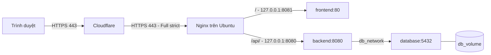

# Nginx trực tiếp trên Ubuntu và Docker — TechByte Service Desk

## 1. Các file và luồng request

| File | Mục đích |
| --- | --- |
| `frontend/Dockerfile` | Node 22 build React/Vite; Nginx phục vụ thư mục `dist` |
| `backend/Dockerfile` | Maven + Java 21 build JAR; Java 21 JRE chạy bằng user thường |
| `docker-compose.yml` | Chạy bộ production trên VPS |
| `infra/compose/compose.prod.yml` | Ba service Docker: frontend, backend, database |
| `infra/compose/env.example` | Mẫu biến môi trường; phải sao chép thành `.env` riêng |
| `infra/nginx/default.conf` | Site Nginx Ubuntu cho `anhdang2k7.io.vn` |
| `infra/nginx/frontend.conf` | Static files, cache assets và fallback React Router |



Nginx cài bằng apt trên VPS và sở hữu cổng 80/443. Frontend và backend chỉ publish
cổng trên `127.0.0.1` để Nginx truy cập; database không publish cổng.
`db_network` là mạng nội bộ, chỉ backend và database tham gia.
Nginx trong image frontend vẫn phục vụ React và xử lý fallback `index.html`.

## 2. Chuẩn bị VPS Ubuntu

Đưa các file Docker/Nginx mới lên nhánh GitHub dùng triển khai trước khi clone/pull
trên VPS. Có thể dùng thư mục dự án đã clone sẵn; các lệnh dưới đây giả định repo
ở `/opt/techbyte/source` và bạn đang đứng tại thư mục đó.

Cài Docker theo [hướng dẫn Ubuntu chính thức](https://docs.docker.com/engine/install/ubuntu/).
Nếu VPS chưa cài Docker, dùng apt repository của Docker:

```bash
sudo apt update
sudo apt install -y ca-certificates curl git openssl
sudo install -m 0755 -d /etc/apt/keyrings
sudo curl -fsSL https://download.docker.com/linux/ubuntu/gpg -o /etc/apt/keyrings/docker.asc
sudo chmod a+r /etc/apt/keyrings/docker.asc

sudo tee /etc/apt/sources.list.d/docker.sources >/dev/null <<EOF
Types: deb
URIs: https://download.docker.com/linux/ubuntu
Suites: $(. /etc/os-release && echo "${UBUNTU_CODENAME:-$VERSION_CODENAME}")
Components: stable
Architectures: $(dpkg --print-architecture)
Signed-By: /etc/apt/keyrings/docker.asc
EOF

sudo apt update
sudo apt install -y docker-ce docker-ce-cli containerd.io docker-buildx-plugin docker-compose-plugin
sudo systemctl enable --now docker
sudo usermod -aG docker "$USER"
```

Đăng xuất rồi SSH lại để nhận quyền nhóm Docker, sau đó kiểm tra:

```bash
docker version
docker compose version
```

Kiểm tra cổng trước khi cài Nginx:

```bash
sudo ss -ltnp '( sport = :80 or sport = :443 )'
docker ps --filter label=com.docker.compose.project=techbyte \
  --filter label=com.docker.compose.service=reverse-proxy --format '{{.Names}}'
```

Nếu chuyển từ phiên bản proxy Docker, dừng và xóa đúng container được liệt kê
bằng `docker stop TEN_CONTAINER` rồi `docker rm TEN_CONTAINER` để giải phóng cổng.
Không dừng database/backend/frontend hoặc xóa volume. Chuyển đổi này làm website
tạm gián đoạn cho tới khi Nginx và ứng dụng đã được cấu hình xong.

```bash
sudo apt update
sudo apt install -y nginx curl jq openssl util-linux
```

Firewall của nhà cung cấp VPS cần cho phép TCP 80/443 và SSH theo quy định lab.
Nếu UFW đang bật, chạy `sudo ufw allow 'Nginx Full'`.

## 3. Domain và chứng chỉ Cloudflare

Tên miền: `anhdang2k7.io.vn`.

1. Cloudflare DNS: bản ghi `A`, tên `@`, trỏ tới IPv4 VPS và bật **Proxied**.
2. Vào **SSL/TLS -> Origin Server -> Create Certificate**. Tạo chứng chỉ cho đúng
   hostname; lưu Origin Certificate và Private Key vào hai file bên dưới.
3. Vào **SSL/TLS -> Overview**, chọn **Full (strict)**. Origin phải có chứng chỉ đúng
   hostname, còn hạn. Chứng chỉ Origin CA dùng cho chặng Cloudflare -> VPS.
4. Đặt quy tắc bypass cache cho `/api/*`; không dùng cache toàn bộ website cho API
   hoặc phản hồi đăng nhập.

[Hướng dẫn Origin CA](https://developers.cloudflare.com/ssl/origin-configuration/origin-ca/)
và [Full (strict)](https://developers.cloudflare.com/ssl/origin-configuration/ssl-modes/full-strict/).

Tạo thư mục và lưu chứng chỉ trên VPS:

```bash
sudo install -d -m 0700 /etc/nginx/ssl
sudo nano /etc/nginx/ssl/anhdang2k7.io.vn.crt
sudo nano /etc/nginx/ssl/anhdang2k7.io.vn.key
sudo chmod 644 /etc/nginx/ssl/anhdang2k7.io.vn.crt
sudo chmod 600 /etc/nginx/ssl/anhdang2k7.io.vn.key
```

File `.crt` chứa khối `BEGIN CERTIFICATE`; file `.key` chứa private key tương ứng.
Nếu đã có cặp chứng chỉ ở `/opt/techbyte/shared/tls`, có thể sao chép chúng vào
hai đường dẫn mới bằng `sudo install -m 644` cho cert và `sudo install -m 600`
cho key. Giữ chúng ngoài repository. Duy trì DNS Proxied vì Origin CA chỉ được
Cloudflare tin cậy, trình duyệt truy cập thẳng origin có thể báo lỗi chứng chỉ.

Cài site từ thư mục root repo trên VPS:

```bash
sudo install -m 644 infra/nginx/default.conf /etc/nginx/sites-available/anhdang2k7.io.vn
sudo ln -s /etc/nginx/sites-available/anhdang2k7.io.vn /etc/nginx/sites-enabled/anhdang2k7.io.vn
sudo nginx -t && sudo systemctl enable --now nginx && sudo systemctl reload nginx
```

Chỉ tạo symlink một lần; nếu đã tồn tại, kiểm tra nó trỏ đúng file rồi bỏ qua
lệnh `ln`. Nếu site đang hoạt động, sao lưu cấu hình hiện tại trước khi ghi đè.
Chỉ start/reload khi `nginx -t` thành công. Trước khi ứng dụng chạy, Nginx có thể
trả 502; cấu hình upstream dùng địa chỉ cố định nên không ngăn Nginx khởi động.

## 4. Cấu hình biến môi trường production

Trong thư mục repository trên VPS:

```bash
sudo install -d -m 0750 -o "$USER" -g "$(id -gn)" /opt/techbyte
mkdir -p /opt/techbyte/shared /opt/techbyte/incoming /opt/techbyte/releases
test -f /opt/techbyte/shared/.env || cp infra/compose/env.example /opt/techbyte/shared/.env
chmod 600 /opt/techbyte/shared/.env
openssl rand -hex 32
openssl rand -hex 32
nano /opt/techbyte/shared/.env
```

Dùng hai chuỗi vừa tạo cho hai biến bí mật khác nhau, điền các giá trị còn lại:

```dotenv
POSTGRES_DB=servicedesk
POSTGRES_USER=servicedesk_user
POSTGRES_PASSWORD=<chuỗi-ngẫu-nhiên-thứ-nhất>
JWT_SECRET=<chuỗi-ngẫu-nhiên-thứ-hai>
APP_URL=https://anhdang2k7.io.vn
APP_ENV_FILE=/opt/techbyte/shared/.env
```

Nếu database đã có dữ liệu, giữ nguyên password/user/database hiện tại. Hai chuỗi
ngẫu nhiên dùng cho cài đặt mới; không đổi password chỉ bằng sửa env của PostgreSQL.
`APP_URL` gồm `https://` và dùng cho CORS backend. Domain của Nginx được viết trực
tiếp trong `infra/nginx/default.conf`; đổi domain phải cập nhật cả site, cert và
`APP_URL`. React dùng API `/api` trên cùng domain. Compose không dùng `APP_DOMAIN`
và `TLS_DIR`; có thể bỏ chúng khỏi env cũ.

Database là PostgreSQL 16 theo tài liệu nhóm DB. Named volume thực tế là `db_volume`
và container tên `database` để tương thích các script backup đang có. Xác nhận với
người phụ trách DB nếu VPS đã có một database/volume mang tên này.

## 5. Build và chạy production

Chạy trên VPS. Tạo hàm shell để các lệnh dùng đúng file production:

```bash
export APP_ENV_FILE=/opt/techbyte/shared/.env
dc() {
  docker compose -p techbyte --env-file "$APP_ENV_FILE" -f infra/compose/compose.prod.yml "$@"
}

dc config --quiet
dc up --build -d --remove-orphans --wait --wait-timeout 180
dc ps
sudo nginx -t
dc exec -T backend curl -fsS http://127.0.0.1:8080/ready
curl -I http://127.0.0.1:8081
curl -fsS http://127.0.0.1:8080/api/ready
curl -I https://anhdang2k7.io.vn
curl -fsS https://anhdang2k7.io.vn/api/ready
```

Khởi động lần đầu có thể mất vài phút để tải image, npm packages và Maven dependencies.
Production tắt demo seed; phối hợp nhóm DB/BE tạo tài khoản sử dụng. Readiness trả `{"status":"READY","database":"UP"}`. Spring Boot chạy Flyway trên các SQL trong `database/migrations` đã được đóng gói
vào image, rồi Hibernate chỉ `validate` schema. Không mount SQL vào
`docker-entrypoint-initdb.d` để chạy lại một cơ chế tạo bảng khác.

Một lần build riêng từng image, tại root repo:

```bash
docker build -f frontend/Dockerfile -t techbyte-frontend:local .
docker build -f backend/Dockerfile -t techbyte-backend:local .
```

Với CI/CD, đặt `FRONTEND_IMAGE` và `BACKEND_IMAGE` thành image SHA/digest từ registry,
pull image và chạy `dc up -d --no-build --remove-orphans --wait`. Migrations vẫn đi cùng backend image.
Workflow `.github/workflows/deploy.yml` dùng PostgreSQL 16 và readiness `READY`;
xem [hướng dẫn CI/CD](deployment.md) để cấu hình SSH, registry và release.

## 6. Đọc và cập nhật Nginx

Trong `infra/nginx/default.conf`:

- Cổng 80 redirect tới HTTPS; `/healthz` phục vụ kiểm tra Nginx.
- Cổng 443 đọc cert/key trong `/etc/nginx/ssl` trên Ubuntu.
- `/` chuyển tới `127.0.0.1:8081` (frontend).
- `/api/` chuyển nguyên đường dẫn tới `127.0.0.1:8080` (backend). Không thêm `/` vào cuối
  `proxy_pass`, vì Spring Boot đã có prefix `/api`.
- Nginx trên host dùng cổng cố định; không dùng DNS Docker hoặc tên service.
- FE tự xử lý fallback `index.html`, nên refresh `/tickets/123` không bị 404.

[Quy tắc proxy_pass của Nginx](https://nginx.org/en/docs/http/ngx_http_proxy_module.html#proxy_pass).

Sau khi sửa file repo, cài lại site rồi kiểm tra và reload. Khi chỉ thay cert/key,
bỏ qua lệnh cài site. Deploy lại frontend/backend không cần reload Nginx.

```bash
sudo install -m 644 infra/nginx/default.conf /etc/nginx/sites-available/anhdang2k7.io.vn
sudo nginx -t && sudo systemctl reload nginx
curl -fsS https://anhdang2k7.io.vn/api/ready
```

## 7. Khoanh vùng lỗi

```bash
dc ps
sudo systemctl status nginx --no-pager
sudo tail -n 100 /var/log/nginx/techbyte.error.log
dc logs --tail=100 backend
dc logs --tail=100 database
curl -I http://127.0.0.1:8081
curl -fsS http://127.0.0.1:8080/api/ready
```

| Hiện tượng | Kiểm tra |
| --- | --- |
| API 502 | Backend healthy chưa; cổng loopback 8080; logs BE và Nginx Ubuntu |
| Backend không lên | `prod` profile, DB credentials, lỗi Flyway/schema validation |
| Cloudflare 526 | Chứng chỉ origin, hostname, thời hạn, cặp cert/key |
| Cloudflare 521/522 | Nginx đang chạy, cổng 443, firewall/security group |
| Refresh trang React bị 404 | FE có dùng `infra/nginx/frontend.conf` trong image mới không |
| Đăng nhập không có tài khoản | Production đã tắt demo seed; phối hợp nhóm DB/BE tạo user |

Backup/restore theo các script của nhóm DB trước khi thay đổi schema. Với database
đã có bảng nhưng chưa có Flyway history, cần nhóm DB xác nhận baseline trước; không
tự bật baseline-on-migrate. Các lệnh vận hành không được xóa `db_volume` để chữa lỗi.
